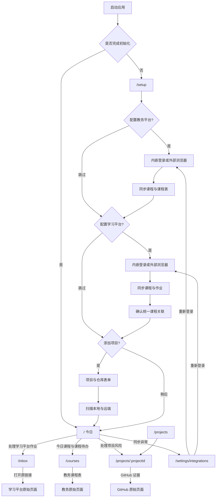
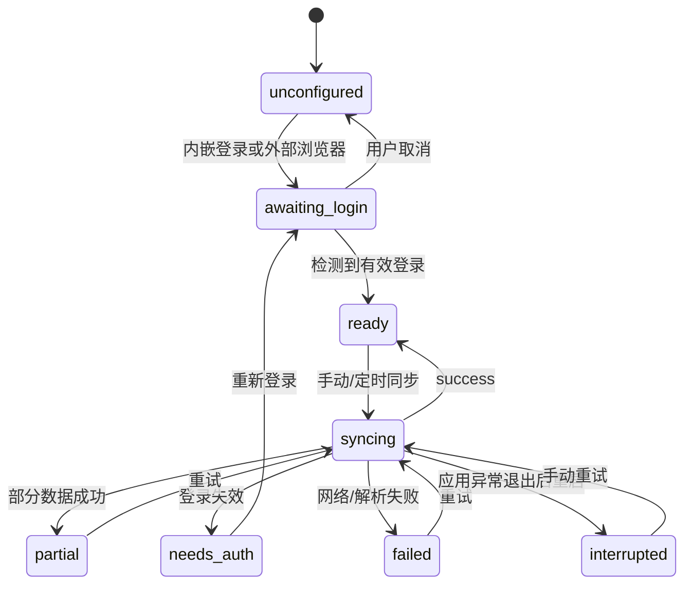

# Student Workbench — 用户流程与交互逻辑

- 文档版本：0.3.0
- 对应范围：PRD 的 P0
- 前端路由与组件约定见 `FRONTEND_GUIDELINES.md`
- API 与状态定义见 `BACKEND_STRUCTURE.md`

## 1. 信息架构

### 1.1 一级导航

| 路由 | 页面 | 核心任务 |
|---|---|---|
| `/` | 今日 | 处理逾期、今日计划、临近截止和项目风险 |
| `/inbox` | 统一收件箱 | 查看、筛选、计划和完成 WorkItem |
| `/courses` | 课程与课程表 | 查看统一课程、周课程表和平台关联状态 |
| `/courses/:courseId` | 课程详情 | 查看课程表、外部课程身份和跨学习平台待办 |
| `/projects` | 项目 | 查看所有项目健康、里程碑和下一步 |
| `/projects/:projectId` | 项目详情 | 处理项目进度与仓库风险 |
| `/settings/integrations` | 接入与同步 | 教务/学习平台登录、课程映射、GitHub 凭据、同步错误 |
| `/settings` | 设置 | 时区、阈值、本地数据说明 |
| `/setup` | 首次引导 | 初始化最小可用连接与项目 |

### 1.2 全局布局

- 左侧：一级导航。
- 顶部：当前页面标题、全局同步状态、手动同步入口。
- 主区域：页面内容。
- 全局同步指示只展示汇总；具体错误进入 `/settings/integrations`。
- 默认在工作台内嵌登录向导中完成账号密码和验证码输入；复杂 SSO 可回退到 Playwright 独立 Chromium，不使用 iframe 直接嵌入平台网站。

## 2. 页面跳转总览

## 3. 首次启动与引导

### 3.1 初始化检查

1. 前端请求 `GET /api/v1/bootstrap`。
2. 后端返回是否完成引导、连接数量、项目数量、本地时区和版本信息。
3. `setup_completed=false` 时跳转 `/setup`，否则进入 `/`。

### 3.2 引导步骤

#### 步骤一：本地数据说明

展示：

- 数据仅保存在当前电脑。
- 教务/学习平台密码可仅本次输入，也可由用户主动选择保存到系统凭据库；不写入 SQLite 或 Git。
- 验证码由用户在学校页面完成，工作台可保存登录会话减少重复验证。
- Git 操作只读，不会提交或推送代码。
- 数据目录位置和备份提示。

用户点击“开始配置”。

#### 步骤二：教务平台课程表（可跳过）

1. 输入连接名称、入口 URL，选择 `academic_portal_v1`，配置教务与 SSO 允许域名。
2. 选择“内嵌登录向导”或“外部浏览器登录”，可选择保存密码到系统凭据库。
3. 首次同步只读取课程身份和课程表，不展示作业栏目，也不生成作业 WorkItem。
4. 成功后展示课程数和课程表条目数；失败可重试或稍后处理。

#### 步骤三：学习平台作业与课程关联（可跳过）

1. 输入学习平台连接，首个真实适配器为 `chaoxing_v1`，配置平台与 SSO 允许域名。
2. 按同样方式完成内嵌或外部登录，同步学习平台课程、作业、截止时间和外部状态。
3. 系统按学期 + 规范化课程名进行精确匹配：唯一匹配可自动关联，同名或歧义必须人工确认。
4. 用户在课程映射页确认教务课程与学习平台课程的关联；之后新增其他学习平台连接时复用同一批统一课程。
5. 成功后展示统一课程数、来源平台数和新增作业数；失败可跳过，不阻塞引导。

#### 步骤四：第一个项目（可跳过）

1. 输入项目名称。
2. 添加 GitHub `owner/repo`，可只填写公开仓库。
3. 添加本地仓库路径，可只关联远端或只关联本地。
4. 验证后创建项目。
5. 用户填写一个下一步行动；可留空，但项目健康显示黄色原因。
6. 点击“扫描并查看项目”，进入项目详情或今日页。

#### 步骤五：完成

调用 `POST /api/v1/bootstrap/complete`，保存 `setup_completed=true`，跳转 `/`。跳过教务、学习平台或项目不代表删除之后配置的入口。

## 4. 教务/学习平台接入与统一课程流程

### 4.1 连接状态机

连接类型分为 `academic/learning/github`。连接状态与单次 `SyncRun` 状态分开：连接表示当前可用性，SyncRun 表示一次执行历史。

### 4.2 内嵌登录、密码保存与外部回退

1. 用户在 `/settings/integrations` 选择教务或学习平台连接，再选择：
   - **仅本次登录**：不保存密码。
   - **保存密码并自动填充**：通过 `PUT /api/v1/connections/{id}/credential` 保存账号密码到系统凭据库，之后只显示账号标识和 `configured=true`。
2. 默认选择“内嵌登录向导”。前端以 `mode=embedded` 调用 `POST /api/v1/connections/{id}/login`，返回 `202`。
3. 向导根据适配器状态显示账号密码或验证码输入：
   - `POST /login/credentials` 提交当次账号密码，或请求使用已保存凭据。
   - `POST /login/challenge` 提交用户看到的验证码/二次验证输入。
   - 适配器只返回当前挑战所需内容，不向前端暴露 Cookie 或密码。
4. 用户也可选择“外部浏览器登录”，或在内嵌流程不受支持时点击“改用外部浏览器”。后端打开可见 Chromium，用户在真实平台页面完成剩余步骤。
5. 前端轮询连接状态。登录成功后保存独立会话并自动触发首次同步；超时时显示“尚未确认登录”，可继续等待、切换外部浏览器或取消。
6. 验证码不保存、不自动识别或绕过；自动填充失败和特殊二次验证均由用户接管。
7. “清除已保存密码”和“清除浏览器会话”互不影响，均需确认。

### 4.3 两类平台分别同步

同步触发、202 返回、SyncRun 轮询和并发规则保持一致，但同步内容不同：

- **教务连接**：读取外部课程身份和课程表。完成后展示课程身份数、课程表条目数和待确认映射数，不显示作业统计。
- **学习平台连接**：读取外部课程身份和作业。完成后展示课程身份数、新增/更新作业数和待确认映射数。
- 任一平台失败不影响另一个平台或本地数据；同一连接不并发，不同连接可独立同步。

### 4.4 统一课程映射流程

1. 同步完成后进入 `/settings/integrations` 的“课程映射”或 `/courses` 的待确认区域。
2. 每条外部课程身份显示来源平台、外部课程名、学期、教师和原始链接。
3. 系统用“学期 + 规范化课程名”查找候选，教师用于消除歧义：
   - 唯一精确候选可自动关联并标注 `auto_exact`。
   - 多个候选或信息不足时保持 `unmatched`，不强行合并。
4. 用户可选择已有统一课程、创建新课程、解除关联或忽略该外部身份。解除/忽略只调整映射，不删除或自动完成来源作业；忽略后身份移出待匹配列表。
5. 确认后，该身份下的课程表和待办统一指向所选 `course_id`。修改映射时整批更新，不逐条修改作业。
6. 课程详情集中展示：
   - 教务课程表。
   - 所有来源平台的课程身份。
   - 各学习平台作业和其他课程待办。
7. 两个平台重复发布的同一作业保留两个来源，只聚合到同一课程，不自动去重删除。

### 4.5 学习平台作业进入收件箱

- 新作业默认进入 `inbox`，首次已提交/已批改作业进入 `done`。
- 每条事项显示统一课程、来源平台、外部状态、截止时间、来源链接和最后同步时间。
- 点击“查看原平台”打开新标签页，用户自行核实详情。
- 用户修改本地计划后，同步只更新外部字段；课程归属由外部课程身份映射统一维护。
- 完整同步后消失的旧事项显示“来源中未找到，需核实”，可保留、完成、忽略或打开原链接，不自动物理删除。

### 4.6 平台异常文案

| 情况 | 用户文案 | 主操作 | 数据行为 |
|---|---|---|---|
| 未登录 | 尚未完成平台登录 | 内嵌登录/外部浏览器 | 不同步 |
| 会话过期 | 登录已失效，需要重新登录 | 重新登录 | 保留旧数据并标为过期 |
| 网络不可达 | 暂时无法连接平台 | 重试 | 保留旧数据 |
| 页面结构变化 | 平台页面可能已更新，部分信息未能读取 | 查看同步详情 | 不清空数据 |
| 解析为空 | 未确认平台确实没有数据 | 打开原平台核实 | 不将空结果视为零课程/作业 |
| 验证码/挑战 | 请在内嵌向导或外部页面完成验证 | 输入验证码/切换外部浏览器 | 不尝试绕过 |
| 域名不允许 | 页面跳转到了未配置域名 | 检查连接设置 | 停止访问 |
| 课程映射歧义 | 找到多个可能课程，需要确认 | 手动选择课程 | 不自动合并 |

## 5. 项目创建与仓库关联

### 5.1 创建项目与生命周期状态

字段顺序：

1. 项目名称（必填）。
2. 项目说明（可选）。
3. 生命周期状态，默认 `planning`。
4. 目标日期（可选）。
5. 下一步行动（建议填写）。
6. 里程碑列表，可在创建后补充。

项目状态含义：

| 状态 | 含义 | 原因要求 |
|---|---|---|
| `idea` | 只有想法，尚未承诺投入 | 可选 |
| `planning` | 正在拆分目标、里程碑和方案 | 可选 |
| `in_progress` | 正在主动推进 | 可选 |
| `blocked` | 因明确问题无法继续推进 | 必须说明具体阻塞原因 |
| `waiting` | 等待 review、他人、外部依赖或某个日期 | 必须说明等待对象/事件，可填恢复日期 |
| `on_hold` | 用户主动暂停，当前不投入 | 必须说明暂停原因，可填恢复日期 |
| `completed` | 目标已完结 | 可填写完成说明 |
| `cancelled` | 目标取消，不再推进 | 必须说明取消原因 |
| `archived` | 已归档，仅保留历史 | 可选 |

- 每次状态变化保存 `status_reason`、`status_changed_at` 和可选 `resume_at`，并追加状态历史。
- 生命周期状态与健康状态分离：只有 `planning/in_progress/blocked/waiting` 参与健康计算；其余状态显示“无需评估”。
- 保存后进入 `/projects/:projectId`，不强制立即绑定仓库。

### 5.2 添加仓库

一个项目可添加多个仓库。每个仓库表单包含：

- GitHub `owner/repo`，例如 `example/student-workbench`。
- 本地路径，例如 `D:\code\student-workbench`。
- 是否启用。

至少填写一种关联。保存时分别校验：

- GitHub：格式正确；远端是否存在和是否有权限在同步时确认。
- 本地：路径已明确输入，后端检查是否存在 Git 工作树。
- 同一项目内不允许重复添加相同远端或相同规范化本地路径。

### 5.3 本地扫描结果

仓库区域显示：

- 当前分支。
- 未提交文件数。
- ahead/behind 数。
- 最后本地提交时间。
- 本地扫描时间。
- upstream 缺失、detached HEAD 等状态。

ahead/behind 旁固定提示：“相对于本地已有远端引用；未自动 fetch”。扫描失败不影响其他仓库。

### 5.4 GitHub 凭据流程

1. 用户进入 `/settings/integrations` 的 GitHub 区域。
2. 后端只返回 `token_configured=true/false`，永不返回 token。
3. 用户在本地对话框输入 fine-grained PAT，提交到后端。
4. 后端写入 OS 凭据库后立即丢弃请求中的敏感值，不写日志。
5. 前端只显示“已配置”，提供“替换”和“清除”。
6. 公开仓库在无 token 时可尝试只读访问；私有仓库必须明确处理 401/403/404，不能显示为空仓库。

## 6. 项目详情、项目待办与健康处理

### 6.1 页面结构

1. **项目摘要**：生命周期状态、具体原因、目标日期、健康等级、下一步行动。
2. **状态历史**：每次状态变化的时间、前后状态和原因。
3. **健康原因**：按红/黄排序，每条包含证据与来源时间；非评估生命周期显示“无需评估”。
4. **交付进展**：里程碑完成数/总数及里程碑列表。
5. **项目待办**：该项目下全部 WorkItem，可直接新增、计划、开始、完成和标记受阻。
6. **仓库状态**：每个仓库的本地与远端快照。
7. **同步记录**：最近远端同步和本地扫描结果。

### 6.2 修改项目状态与原因

- 修改状态时，根据目标状态动态显示原因和恢复日期字段。
- `blocked/waiting/on_hold/cancelled` 未填写具体原因时不能保存。
- `waiting` 的原因应说明等待谁或什么事件，`blocked` 应说明无法推进的具体问题。
- 保存后更新 `status_reason/status_changed_at/resume_at`，并追加一条状态历史，不覆盖旧记录。
- `blocked` 参与红色健康计算，`waiting` 产生黄色提示；非评估生命周期显示“无需评估”，不继续制造无活动提醒。

### 6.3 下一步行动与项目待办

- 点击“编辑下一步”打开内联输入，保存后更新 `next_action_updated_at`。
- 清空 `planning/in_progress` 项目的下一步后，健康原因立即重新计算为黄色。
- 点击“新增项目待办”，填写标题、截止时间、计划时间、优先级和备注，后端自动写入 `project_id`、`source_type=manual`、`item_type=task`。
- 项目待办同时出现在项目详情和统一收件箱；设置“计划今天”后立即进入今日页，逾期、临近截止和受阻规则与其他 WorkItem 一致。
- 项目 `next_action` 是当前焦点摘要，不自动复制成待办，避免重复；用户可主动点击“转为项目待办”。

### 6.4 管理里程碑

- 新增：标题必填，截止时间可空，默认 `planned`。
- 状态：`planned/in_progress/blocked/done`。
- 标记完成时记录 `completed_at`；恢复未完成时清空。
- 参与健康计算的项目存在未完成逾期里程碑时产生红色原因。
- 删除里程碑需要确认；P0 采用软删除，避免误删历史。

### 6.5 处理健康原因

| 原因 | 页面动作 |
|---|---|
| 项目受阻/等待 | 展示具体原因和恢复日期，可编辑状态或转为项目待办跟踪解除条件 |
| 未提交修改 | 显示本地路径和“复制路径”，由用户在 IDE 处理 |
| 未推送/落后 | 显示 ahead/behind，不提供自动 push/pull |
| CI 失败 | 打开 GitHub 检查链接 |
| 无下一步 | 聚焦下一步输入框 |
| 里程碑逾期 | 滚动到对应里程碑，允许重排或标记完成 |
| 数据过期 | 触发对应仓库同步/扫描 |
| 未知 | 展示缺失的数据来源和配置入口 |

健康卡片只解释现状，不自动修改 Git、GitHub 或项目状态。

## 7. 统一收件箱与今日执行

### 7.1 收件箱筛选

- 来源：全部/学校/手动。
- 归属：课程/项目/未关联。
- 状态：收件箱/已计划/进行中/受阻/完成/忽略。
- 截止：逾期/今天/未来 3 天/无截止。
- 搜索：标题模糊搜索。

筛选条件写入 URL 查询参数，刷新和返回后保留。

### 7.2 编辑事项

- 标题、来源和外部状态只读（手动事项标题可编辑）。
- 学习平台事项的课程归属通过外部课程身份映射统一调整，不在单条作业上形成另一套关联；手动事项可直接编辑课程/项目关联。
- 可编辑：执行状态、优先级、截止时间、计划时间、预计分钟、下一步、备注。
- 截止时间与计划执行时间使用不同字段和不同标签。
- 标记完成后保留来源链接和同步历史。
- 外部状态从 `open` 变为 `submitted` 时显示更新，但不强制覆盖用户执行状态。

### 7.3 今日课程、今日待办与操作

今日页顶部增加“今日课程”信息区，不自动生成待办：

- 根据教务课程表展示当天节次、时间、地点和统一课程名。
- 每门课显示相关未完成待办数，点击后进入 `/courses/:courseId` 或按课程筛选的 `/inbox`。
- 教务课程表未同步、课程身份待确认或缺少 `term_start_date` 时，显示来源状态、映射或学期起始日期确认入口，不伪造课程安排。

今日页的 WorkItem 分组统一包含三类事项：

- 学习平台同步的作业。
- 项目详情中创建的项目待办。
- 未关联课程或项目的手动事项。

项目待办使用与学习平台作业相同的逾期、今日计划、临近未计划和受阻规则，并显示项目名称与项目状态。项目 `next_action` 不自动形成重复待办；红色项目风险单独显示。即使用户把项目暂停或完结，已经明确计划到今天的项目待办仍保留并显示项目状态，避免静默遗漏。

操作：

- “开始”：`inbox/planned → in_progress`。
- “完成”：任意未完成状态 `→ done`。
- “计划今天”：设置 `planned_start/end` 到本地今日，状态变为 `planned`。
- “移回收件箱”：清除计划时间，状态变为 `inbox`。
- “受阻”：填写受阻原因，状态变为 `blocked`。
- 项目待办点击项目名称进入项目详情；项目风险点击后定位到具体原因。

所有变更成功后，使今日、收件箱、项目详情相关查询缓存失效并重新获取。

## 8. 同步中心

### 8.1 页面内容

每个连接或仓库显示：

- 当前状态。
- 最后尝试与最后成功时间。
- 正在运行的 SyncRun。
- 最近错误代码与脱敏摘要。
- 手动同步/扫描、重新登录、配置入口。

下方展示最近 20 次 SyncRun，可按来源筛选。

### 8.2 并发与离开页面

- 同一连接重复同步返回 `409 SYNC_ALREADY_RUNNING`，前端直接附着到现有 SyncRun，而不是弹出死错误。
- 教务、学习平台与 GitHub 可并行，各自独立；同一课程身份映射变更需在对应同步完成后提交。
- 本地扫描与远端同步可以并行，但快照分别写入。
- 页面卸载不取消后端同步。
- 应用重启时将未完成的运行记录标记为 `interrupted`。

## 9. 通用页面状态

### 9.1 加载

- 首次加载使用骨架屏。
- 已有数据的后台刷新不清空列表，只显示小型刷新状态。

### 9.2 空状态

- 无学校连接：引导配置，不显示“没有作业”。
- 已连接但无事项：显示最后同步时间和“打开原平台核实”。
- 无项目：引导新建项目。
- 无健康原因且数据完整：显示“当前未发现规则覆盖的风险”，不宣称项目一定健康。

### 9.3 错误与过期

- 错误提示包含可执行动作，不仅显示错误码。
- 旧数据继续展示，并显著标注最后成功时间。
- 前端请求失败不自动清空 TanStack Query 中已有数据。
- 外部同步失败不重试写操作；用户编辑的本地 mutation 也不自动盲目重放。

## 10. 键盘、可访问性与反馈

- 所有表单可用键盘完成，错误与字段关联。
- 颜色之外使用文字和图标表达健康、状态和优先级。
- 对话框打开后聚焦标题，关闭后返回触发按钮。
- 外部链接注明“新窗口打开”。
- 本地写操作显示成功反馈；同步反馈展示统计而非只显示“成功”。
- 危险操作仅包括清除平台密码、清除平台会话、清除 GitHub token、删除里程碑等，必须确认。

## 11. MVP 核心端到端路径

### 路径 A：作业进入今日计划

`/setup` → 教务同步课程表 → 学习平台同步作业 → 确认统一课程关联 → `/inbox` → 选择作业 → 计划今天 → `/` → 今日课程与今日待办互相定位 → 开始学习平台作业并完成 → 原平台链接仍可追溯。

### 路径 B：处理本地项目风险

`/projects` → 新建项目 → 关联本地与 GitHub → 扫描 → 发现未提交/CI 失败 → `/projects/:projectId` → 查看证据 → 用户在 IDE/GitHub 处理 → 重新扫描 → 风险消失。

### 路径 C：同步失败降级

教务或学习平台同步 → 会话过期 → `needs_auth` → 今日课程、今日待办与收件箱继续可用 → 内嵌或外部重新登录 → 同步恢复 → 本地计划、备注和课程映射保持不变。

### 路径 D：项目待办进入今日

`/projects/:projectId` → 新增项目待办 → 计划今天 → `/` → 开始并完成 → 返回项目详情查看待办进展。另一个分支是将项目改为 `blocked/waiting/on_hold` → 填写具体原因和可选恢复日期 → 状态历史新增记录。
