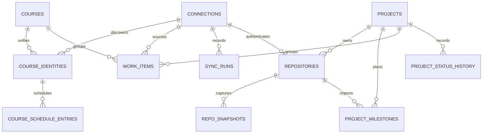

# Student Workbench — 后端结构、数据模型与 API

- 文档版本：0.3.0
- API 前缀：`/api/v1`
- 持久化：SQLite + SQLAlchemy + Alembic
- 核心原则：领域规则独立于 Web、ORM 和第三方平台

## 1. 后端职责

- 提供本地 REST API 与 OpenAPI。
- 管理本地设置、课程、事项、项目、里程碑、仓库和同步记录。
- 协调教务平台、学习平台、GitHub 和本地 Git 的只读采集。
- 归并外部数据，同时保留用户编辑字段。
- 计算可解释的项目健康读模型。
- 保护教务/学习平台会话和 GitHub token。
- 在本地使用模式下托管前端构建产物。

## 2. 分层结构

```text
src/student_workbench/
├── api/
│   ├── dependencies.py
│   ├── errors.py
│   ├── routes/
│   │   ├── bootstrap.py
│   │   ├── today.py
│   │   ├── work_items.py
│   │   ├── courses.py
│   │   ├── projects.py
│   │   ├── repositories.py
│   │   ├── connections.py
│   │   ├── sync_runs.py
│   │   └── settings.py
│   └── schemas/                 # API 专用 Pydantic 模型
├── domain/
│   ├── models.py                # 纯 Python 领域值对象/DTO
│   ├── enums.py
│   ├── health.py                # 项目健康纯函数
│   ├── merge.py                 # 外部数据与本地字段归并
│   └── time.py
├── integrations/
│   ├── platform/
│   │   ├── base.py              # 登录/会话/挑战共享契约
│   │   ├── credentials.py
│   │   ├── dto.py
│   │   └── errors.py
│   ├── academic/
│   │   ├── base.py              # AcademicAdapter：课程身份与课程表
│   │   ├── academic_portal_v1.py
│   │   └── fake.py
│   ├── learning/
│   │   ├── base.py              # LearningAdapter：课程身份与作业
│   │   ├── chaoxing_v1.py
│   │   └── fake.py
│   ├── github/
│   │   ├── client.py
│   │   ├── dto.py
│   │   └── credentials.py
│   └── local_git/
│       ├── scanner.py
│       └── commands.py
├── persistence/
│   ├── models.py                # SQLAlchemy ORM
│   ├── session.py
│   ├── unit_of_work.py
│   └── repositories/
├── services/
│   ├── academic_sync.py
│   ├── learning_sync.py
│   ├── course_mapping.py
│   ├── github_sync.py
│   ├── local_scan.py
│   ├── project_queries.py
│   ├── work_item_service.py
│   └── sync_executor.py
├── settings.py
├── security.py
├── main.py
└── cli.py
```

### 2.1 依赖规则

- `domain` 不导入 FastAPI、SQLAlchemy、HTTPX、Playwright。
- `integrations` 返回 DTO 或抛出稳定领域异常，不直接写数据库。
- `services` 负责事务边界、同步协调和调用领域规则。
- `api` 只做参数校验、用例调用和响应/错误映射。
- ORM model 不直接作为 API response 返回。

## 3. 核心枚举

```text
ConnectionKind: academic | learning | github
ConnectionStatus: unconfigured | awaiting_login | ready | syncing |
                  partial | needs_auth | failed | interrupted

SyncRunStatus: queued | running | success | partial | failed |
               needs_auth | interrupted
SyncTrigger: manual | scheduled | startup

SourceType: manual | learning | academic | github
WorkItemType: assignment | exam | task | milestone
WorkflowStatus: inbox | planned | in_progress | blocked | done | dismissed
ExternalStatus: open | submitted | graded | closed | unknown
Priority: low | medium | high | urgent
CourseMatchStatus: unmatched | linked | ignored
CourseMatchMethod: auto_exact | manual | new_course | none
WeekPattern: all | odd | even | custom
LoginMode: embedded | browser

ProjectStatus: idea | planning | in_progress | blocked | waiting |
              on_hold | completed | cancelled | archived
MilestoneStatus: planned | in_progress | blocked | done
SnapshotKind: local | remote
SnapshotStatus: success | partial | failed
HealthLevel: green | yellow | red | unknown | inactive
```

所有枚举在数据库中以稳定字符串保存，不使用整数序号。

## 4. 核心数据模型

### 4.1 ER 图



`settings` 为独立的单行表，不与其他实体建立外键。

### 4.2 通用约定

- 主键：UUID 字符串，由应用生成。
- 时间：`created_at/updated_at/..._at` 均保存 UTC ISO 8601，领域层使用带时区 datetime。
- 日期：`target_date` 使用 `YYYY-MM-DD`，不隐含 UTC 转换。
- JSON：仅用于允许域名、健康原因等真正动态的数据；核心查询字段必须列化。
- 删除：P0 的里程碑使用 `deleted_at`；其他实体暂不提供物理删除 API。
- 外部 ID：只在对应连接内保证唯一，不能全局唯一。

### 4.3 `settings`

单行表，`id=1`。

| 字段 | 类型 | 说明 |
|---|---|---|
| id | Integer PK | 固定 1 |
| setup_completed | Boolean | 是否完成首次引导 |
| timezone | String | IANA 时区，默认 `Asia/Shanghai` |
| upcoming_days | Integer | 临近截止天数，默认 3 |
| stale_after_hours | Integer | 数据过期阈值，默认 72（P0 手动同步场景） |
| inactive_project_days | Integer | 项目无活动提示阈值，默认 14 |
| created_at / updated_at | DateTime | 审计 |

### 4.4 `connections`

教务、学习平台与 GitHub 仓库连接共用，不保存密码或 token。

| 字段 | 类型 | 说明 |
|---|---|---|
| id | UUID PK | |
| kind | String | academic/learning/github |
| name | String | 展示名称 |
| adapter_key | String | academic_portal_v1/chaoxing_v1/github_rest |
| base_url | String | 学校入口或 GitHub API 地址 |
| account_login | String nullable | 可选学校账号标识；密码绝不存此表 |
| allowed_hosts_json | JSON | 学校和 SSO 或 API 允许域名 |
| session_dir | String nullable | 学校浏览器目录的相对标识，不保存 Cookie 到 DB |
| status | String | ConnectionStatus |
| last_attempt_at | DateTime nullable | 最近尝试 |
| last_success_at | DateTime nullable | 最近成功 |
| last_error_code | String nullable | 稳定错误码 |
| last_error_message | String nullable | 脱敏摘要 |
| created_at / updated_at | DateTime | |

约束：

- `adapter_key` 必须在注册表中。
- GitHub 连接的 `base_url` P0 固定官方 API；不允许前端任意修改。
- `session_dir` 只能是应用数据目录内受控标识，不能用于路径穿越。

### 4.5 `courses`

用户可见的统一课程，不直接绑定某一个平台。一个统一课程可关联教务平台和多个学习平台的外部课程身份。

| 字段 | 类型 | 说明 |
|---|---|---|
| id | UUID PK | |
| name | String | 统一课程名 |
| normalized_name | String | 去空白、统一大小写与常见标点后的匹配名 |
| term | String nullable | 统一学期 |
| term_start_date | Date nullable | 第一教学周周一，用于按实际日期计算教学周；缺失时不猜测 |
| teacher | String nullable | 教师，可为空 |
| is_active | Boolean | 是否在当前学期展示 |
| created_at / updated_at | DateTime | |

索引：`(term, normalized_name)`。不通过数据库唯一键强行合并同名课程；是否属于同一课程由精确匹配规则和用户确认决定。

### 4.6 `course_identities`

某个教务或学习平台中的外部课程身份。

| 字段 | 类型 | 说明 |
|---|---|---|
| id | UUID PK | |
| connection_id | UUID FK connections | 来源平台连接 |
| course_id | UUID FK courses nullable | 已关联的统一课程，unmatched/ignored 可为空 |
| external_id | String | 平台外部课程 ID |
| external_name | String | 平台原始课程名 |
| external_term | String nullable | 平台原始学期 |
| external_teacher | String nullable | 平台原始教师 |
| source_url | String nullable | 原课程页 |
| match_status | String | unmatched/linked/ignored |
| match_method | String | auto_exact/manual/new_course/none |
| last_synced_at | DateTime | 最近同步 |
| created_at / updated_at | DateTime | |

约束与索引：

- 唯一约束：`(connection_id, external_id)`，同一平台重复同步不产生新身份。
- `match_status=linked` 时 `course_id` 必填；解除关联后回到 `unmatched`。
- 索引：`course_id`、`match_status`、`(connection_id, external_name)`。
- 唯一精确候选可 `auto_exact`；歧义保持 `unmatched`，手动关联为 `manual`，无候选时新建统一课程为 `new_course`。
- 修改 `course_id` 时，同事务更新该身份下课程表展示归属和 WorkItem 的 `course_id`。
- `unlink` 清除身份及来源 WorkItem 的课程归属，但保留来源数据；`ignore` 还会将身份移出待匹配列表，不把来源 WorkItem 自动设为 done/dismissed。

### 4.7 `course_schedule_entries`

教务课程表条目，不是 WorkItem，不自动生成待办。

| 字段 | 类型 | 说明 |
|---|---|---|
| id | UUID PK | |
| connection_id | UUID FK connections | 教务连接 |
| identity_id | UUID FK course_identities | 对应教务外部课程身份 |
| external_id | String | 平台课程表条目 ID |
| day_of_week | Integer | 1=周一，7=周日 |
| start_time / end_time | String | 本地 `%H:%M` 时间 |
| start_week / end_week | Integer | 起止教学周 |
| week_pattern | String | all/odd/even/custom |
| weeks_json | JSON nullable | custom 时的明确周次数组 |
| location | String nullable | 上课地点 |
| teacher_name | String nullable | 课程表教师 |
| source_url | String nullable | 原课程表页 |
| last_synced_at | DateTime | 最近同步 |
| created_at / updated_at | DateTime | |

唯一约束：`(connection_id, external_id)`。索引：`(identity_id, day_of_week)`、`(connection_id, last_synced_at)`。只有身份已 `linked` 时才归入统一课程展示；未匹配条目保留，等待用户确认。

### 4.8 `work_items`

| 字段 | 类型 | 说明 |
|---|---|---|
| id | UUID PK | |
| source_type | String | manual/learning/academic/github；P0 外部待办主要来自 learning |
| connection_id | UUID FK connections nullable | 外部来源，手动为空 |
| external_id | String nullable | 外部作业/事项 ID |
| course_id | UUID FK courses nullable | 课程归属 |
| project_id | UUID FK projects nullable | 项目归属 |
| title | String | 标题 |
| description | Text nullable | 必要摘要，不默认保存整页 HTML |
| item_type | String | assignment/exam/task/milestone |
| workflow_status | String | 用户执行状态 |
| external_status | String | 外部状态，手动事项为 unknown |
| priority | String | 默认 medium |
| due_at | DateTime nullable | 截止时间 |
| planned_start_at | DateTime nullable | 计划执行开始 |
| planned_end_at | DateTime nullable | 计划执行结束 |
| estimate_minutes | Integer nullable | 预计工作量 |
| next_action | Text nullable | 下一步行动 |
| notes | Text nullable | 用户备注 |
| blocked_reason | Text nullable | 用户受阻原因 |
| source_url | String nullable | 原始链接 |
| source_updated_at | DateTime nullable | 平台提供的更新时间 |
| last_synced_at | DateTime nullable | 最近成功读取时间 |
| needs_review | Boolean | 来源消失、字段冲突或需核实 |
| completed_at | DateTime nullable | 本地完成时间 |
| created_at / updated_at | DateTime | |

约束与索引：

- 外部事项唯一：`(connection_id, external_id)`；手动事项二者均为空。
- `planned_end_at > planned_start_at`（二者均非空时）。
- `workflow_status=blocked` 时 `blocked_reason` 必填。
- `workflow_status=done` 时 `completed_at` 必填；离开 done 时清空。
- 索引：`(workflow_status, due_at)`、`(course_id, workflow_status)`、`(project_id, workflow_status)`、`last_synced_at`。
- 外部同步不可覆盖用户字段：`workflow_status/priority/planned_*/estimate_minutes/next_action/notes/blocked_reason/project_id`。
- 学习平台事项的 `course_id` 由其外部 `course_identity` 映射统一维护；手动事项可直接编辑课程。身份改绑时，同事务批量更新该身份下 WorkItem，不覆盖项目关联和其他用户字段。
- 同一作业在多个学习平台重复发布时保留不同 `(connection_id, external_id)` 来源事项，只统一课程归属，不自动合并删除。

首次导入状态映射：`open → inbox`，`submitted/graded → done`，其他状态默认 `inbox`；后续只更新 `external_status` 和来源字段。

### 4.9 `projects`

| 字段 | 类型 | 说明 |
|---|---|---|
| id | UUID PK | |
| name | String | 项目名 |
| description | Text nullable | |
| status | String | idea/planning/in_progress/blocked/waiting/on_hold/completed/cancelled/archived，默认 planning |
| status_reason | Text nullable | 当前状态的具体原因 |
| status_changed_at | DateTime | 当前状态变更时间 |
| resume_at | DateTime nullable | waiting/on_hold 的可选恢复日期 |
| target_date | Date nullable | 目标交付日期 |
| next_action | Text nullable | 当前下一步摘要，不自动形成待办 |
| next_action_updated_at | DateTime nullable | 下一步更新时间 |
| created_at / updated_at | DateTime | |

约束与索引：

- `blocked/waiting/on_hold/cancelled` 时 `status_reason` 必填；其他状态可选。
- `waiting/on_hold` 可设置 `resume_at`；清除状态时按规则清空不再适用的原因和恢复日期。
- 只有 `planning/in_progress/blocked/waiting` 参与健康计算，其他状态为 `inactive`。
- 索引：`(status, target_date)`、`status_changed_at`。
- 项目待办直接复用 `work_items.project_id`；`next_action` 只有用户显式转换时才创建 WorkItem。

### 4.10 `project_status_history`

追加式状态历史，不更新、不删除旧记录。

| 字段 | 类型 | 说明 |
|---|---|---|
| id | UUID PK | |
| project_id | UUID FK projects | |
| from_status | String nullable | 创建项目时为空 |
| to_status | String | 新状态 |
| reason | Text nullable | 当次状态原因快照 |
| changed_at | DateTime | 变更时间 |

索引：`(project_id, changed_at)`。项目创建和每次状态变化均写入，供项目详情和 P1 确定性周报使用。

### 4.11 `repositories`

一个项目可有多个仓库；MVP 中同一个远端或本地目录只关联一个项目。

| 字段 | 类型 | 说明 |
|---|---|---|
| id | UUID PK | |
| project_id | UUID FK projects | |
| connection_id | UUID FK connections nullable unique | GitHub 连接，仅本地仓库为空 |
| provider | String | github/local |
| owner | String nullable | GitHub owner |
| name | String | 仓库名 |
| full_name | String nullable unique | owner/repo |
| local_path | String nullable unique | 规范化绝对路径 |
| default_branch | String nullable | 远端同步后更新 |
| enabled | Boolean | 是否参与同步和健康 |
| last_local_scan_at | DateTime nullable | |
| last_remote_sync_at | DateTime nullable | |
| created_at / updated_at | DateTime | |

约束：至少 `connection_id` 或 `local_path` 一项非空。`local_path` 由后端规范化，不接受相对路径。

### 4.12 `project_milestones`

| 字段 | 类型 | 说明 |
|---|---|---|
| id | UUID PK | |
| project_id | UUID FK projects | |
| repository_id | UUID FK repositories nullable | GitHub 里程碑来源 |
| external_id | String nullable | 外部里程碑编号 |
| title | String | |
| due_at | DateTime nullable | |
| status | String | 本地执行状态 |
| external_status | String | open/closed/unknown |
| completed_at | DateTime nullable | 本地完成时间 |
| source_url | String nullable | |
| last_synced_at | DateTime nullable | |
| deleted_at | DateTime nullable | 软删除 |
| created_at / updated_at | DateTime | |

外部唯一约束：`(repository_id, external_id)`。首次导入 open→planned、closed→done；后续同步不覆盖本地 `status` 和 `completed_at`。

### 4.13 `repo_snapshots`

本地与远端分别追加快照，项目详情各取最新一条，避免两种新鲜度混淆。

| 字段 | 类型 | 说明 |
|---|---|---|
| id | UUID PK | |
| repository_id | UUID FK repositories | |
| kind | String | local/remote |
| status | String | success/partial/failed |
| captured_at | DateTime | 采集时间 |
| error_code / error_message | String nullable | 脱敏错误 |
| branch | String nullable | 本地分支或远端默认分支 |
| upstream | String nullable | 本地 upstream |
| detached_head | Boolean nullable | 本地状态 |
| dirty_file_count | Integer nullable | 本地脏文件数 |
| ahead_count / behind_count | Integer nullable | 相对本地 remote-tracking ref |
| last_local_commit_at | DateTime nullable | |
| open_issue_count | Integer nullable | 不含 PR |
| open_pr_count | Integer nullable | |
| review_requested_pr_count | Integer nullable | |
| checks_state | String nullable | success/failure/pending/unknown |
| failing_check_count | Integer nullable | |
| last_remote_commit_at | DateTime nullable | |
| evidence_url | String nullable | 仓库或检查页 |
| created_at | DateTime | |

索引：`(repository_id, kind, captured_at)`。失败快照不覆盖最近成功快照，但会作为最新错误展示；健康计算必须知道成功数据的新鲜度。

### 4.14 `sync_runs`

| 字段 | 类型 | 说明 |
|---|---|---|
| id | UUID PK | |
| connection_id | UUID FK connections | 学校或 GitHub 连接 |
| trigger | String | manual/scheduled/startup |
| status | String | SyncRunStatus |
| scanned_count | Integer | 默认 0 |
| created_count | Integer | 默认 0 |
| updated_count | Integer | 默认 0 |
| review_count | Integer | 默认 0 |
| error_code | String nullable | |
| error_message | String nullable | 脱敏摘要 |
| queued_at | DateTime | |
| started_at | DateTime nullable | |
| finished_at | DateTime nullable | |

索引：`(connection_id, queued_at)`、`(status, queued_at)`。活动判断为 `queued/running`。

### 4.15 健康读模型（不落库）

```json
{
  "level": "yellow",
  "reasons": [
    {
      "code": "LOCAL_UNPUSHED_COMMITS",
      "severity": "yellow",
      "message": "有 3 个本地提交尚未推送",
      "evidence": {"ahead_count": 3, "repository_id": "uuid"},
      "source": "local_git",
      "detected_at": "2026-11-22T08:00:00Z"
    }
  ],
  "inputs": {
    "latest_local_success_at": "2026-11-22T08:00:00Z",
    "latest_remote_success_at": "2026-11-22T07:55:00Z"
  }
}
```

健康由 `project + milestones + latest successful snapshots + settings + now` 纯函数计算。只有 `planning/in_progress/blocked/waiting` 参与评估；`idea/on_hold/completed/cancelled/archived` 直接返回 `inactive`，不要求仓库快照。`blocked` 使用当前 `status_reason` 形成红色原因，`waiting` 使用原因和 `resume_at` 形成黄色原因；状态历史用于展示和后续周报，不反推当前状态。

失败快照用于过期/错误提示，不把远端 401 解释为“0 Issue、0 PR、CI 正常”。

## 5. 外部适配器契约

### 5.1 PlatformAdapter、AcademicAdapter 与 LearningAdapter

共享登录契约：

```python
class PlatformAdapter(Protocol):
    async def start_login(self, connection: ConnectionDTO, mode: LoginMode) -> LoginState: ...
    async def submit_credentials(
        self, connection: ConnectionDTO, credentials: LoginCredentials | None
    ) -> LoginState: ...
    async def submit_challenge(
        self, connection: ConnectionDTO, challenge: ChallengeAnswer
    ) -> LoginState: ...
    async def open_external_login(self, connection: ConnectionDTO) -> None: ...
    async def check_session(self, connection: ConnectionDTO) -> SessionState: ...
    async def cancel_login(self, connection: ConnectionDTO) -> None: ...
    async def clear_session(self, connection: ConnectionDTO) -> None: ...
```

- `mode=embedded` 时，前端只展示本地登录向导和适配器返回的挑战；`credentials=None` 表示使用已保存凭据。
- `mode=browser` 或内嵌流程不支持时，使用独立可见 Chromium 回退。
- 不通过 iframe 直接加载第三方平台页面。

教务契约：

```python
class AcademicAdapter(PlatformAdapter, Protocol):
    async def fetch_course_identities(
        self, connection: ConnectionDTO
    ) -> list[CourseIdentityDTO]: ...
    async def fetch_schedule(
        self, connection: ConnectionDTO, identity: CourseIdentityDTO
    ) -> list[ScheduleEntryDTO]: ...
```

学习平台契约：

```python
class LearningAdapter(PlatformAdapter, Protocol):
    async def fetch_course_identities(
        self, connection: ConnectionDTO
    ) -> list[CourseIdentityDTO]: ...
    async def fetch_assignments(
        self, connection: ConnectionDTO, identity: CourseIdentityDTO
    ) -> list[AssignmentDTO]: ...
```

凭据与登录规则：

- `ConnectionDTO` 只包含 `account_login` 和非秘密配置，不包含密码。
- 适配器通过后端 `CredentialStore` 按需读取 `platform:{connection_id}` 对应的密码；凭据不得写入 DTO、日志或同步记录。
- 自动填充仅限允许的平台/SSO 域名；域名不匹配时不得填充。
- 验证码、二次验证由用户在内嵌向导或外部页面接管；只保存会话，不保存一次性验证码，不识别或绕过验证码。
- `CredentialStore` 与 GitHub token 共用 keyring 基础设施，但平台密码、GitHub token 使用不同的键和清除操作。

稳定异常：

- `PlatformAuthRequired`
- `PlatformChallengeRequired`
- `PlatformNetworkError`
- `PlatformStructureChanged`
- `PlatformDomainNotAllowed`
- `PlatformPartialData`

适配器必须区分“确定空列表”和“未解析到预期容器”。后者抛结构异常，不能返回空列表。`AcademicAdapter` 不包含作业接口，`LearningAdapter` 不负责生成课程表。

### 5.2 GitHubClient

接口：

- `get_repository(full_name)`
- `get_open_issue_count_excluding_prs(full_name)`
- `get_open_prs(full_name)`
- `get_review_requested_pr_count(full_name)`
- `get_default_branch_checks(full_name, branch)`
- `get_latest_commit(full_name, branch)`
- `get_milestones(full_name)`

要求：

- 使用稳定超时、User-Agent、分页和 Link header。
- 处理 401/403/404/429/5xx；读取 `X-RateLimit-*` 和 `Retry-After`。
- token 只从凭据服务注入，不能进入 DTO、日志或响应。
- 无有效用户上下文时，`review_requested_pr_count` 为 unknown，不得填 0。
- API 客户端不将 GitHub model 直接泄露到核心领域层。

### 5.3 LocalGitScanner

- 输入：规范化绝对路径。
- 输出：`LocalRepoSnapshotDTO` 或稳定扫描错误。
- 通过 `subprocess` 参数数组执行，无 `shell=True`。
- 命令只读，设置超时，捕获 stderr 并脱敏。
- 不继承含 GitHub token 的不必要环境变量。
- 支持无 upstream、detached HEAD、空仓库、非 Git 目录、路径不存在。

## 6. 同步归并与事务

### 6.1 教务同步顺序

1. 检查连接活动锁，创建 queued SyncRun，标记 running 并检查会话。
2. 获取外部课程身份，按 `(connection_id, external_id)` upsert `course_identities`。
3. 逐身份读取课程表，按 `(connection_id, external_id)` upsert `course_schedule_entries`。
4. 执行精确课程匹配或保留 `unmatched`，不创建 WorkItem。
5. 更新课程身份数、课程表条目数、待确认映射数和 SyncRun。
6. 单课程失败可形成 partial；全局认证失败不提交伪造空状态。

### 6.2 学习平台同步顺序

1. 检查连接活动锁，创建 queued SyncRun，标记 running 并检查会话。
2. 获取外部课程身份并 upsert，执行精确课程匹配或保留 `unmatched`。
3. 逐身份读取作业并转换为标准 DTO，在事务中归并，保留本地编辑字段。
4. 根据课程身份当前映射更新 WorkItem.course_id；未匹配时可为空并显示待确认。
5. 对确认完整同步后消失的旧事项设置 `needs_review=true`。
6. 更新统计、连接状态和 SyncRun；单课程失败可形成 partial。

### 6.3 统一课程匹配与归并字段

匹配规则：

- 使用“学期 + 规范化课程名”精确匹配，教师用于消除同名歧义。
- 唯一候选可 `auto_exact`，歧义保持 `unmatched`，人工关联为 `manual`，无候选时新建统一课程为 `new_course`。
- 不使用模糊相似度直接合并；用户可解除、改绑或忽略外部身份。
- 改绑时同事务更新该身份下课程表展示归属和 WorkItem.course_id，其他身份不受影响。
- 多平台重复发布的作业保留不同来源，不自动合并删除。

归并字段矩阵：

| 字段组 | 首次导入 | 后续同步/改绑 |
|---|---|---|
| 外部课程身份、课程表字段 | 写入 | 按来源更新 |
| 统一课程 course_id | 按精确规则或待确认 | 只有映射变化时整批更新 |
| 作业标题、截止、来源 URL | 写入 | 更新 |
| 外部状态 | 映射并保存 | 更新 external_status |
| workflow_status | 按首次规则 | 保留 |
| 优先级、计划、预计时间 | 默认/空 | 保留 |
| 下一步、备注、项目关联 | 空 | 保留 |
| needs_review | false | 按完整性与来源缺失规则更新 |
| last_synced_at | 当前同步时间 | 当前同步时间 |

### 6.4 健康输入

只使用最近成功或部分成功且字段可信的快照。任何失败字段保持 unknown，不默认填 0。健康计算不修改数据库，由查询服务组装。

## 7. REST API

### 7.1 通用约定

- 请求和响应：`application/json`。
- 列表响应：`{"items": [], "total": 0, "limit": 50, "offset": 0}`。
- `limit` 默认 50，最大 200。
- 所有写操作返回更新后的资源；异步同步返回 SyncRun。
- OpenAPI 响应必须显式声明，不让前端依赖无类型字典。

错误格式：

```json
{
  "error": {
    "code": "SYNC_ALREADY_RUNNING",
    "message": "该连接正在同步",
    "details": {"sync_run_id": "uuid"},
    "request_id": "uuid"
  }
}
```

常用状态码：400 参数语义错误、404 资源不存在、409 状态冲突、422 校验失败、502 外部平台错误、504 外部超时。异步同步的外部错误通常体现在 SyncRun 中。

### 7.2 Bootstrap 与设置

| 方法 | 路径 | 功能 | 响应 |
|---|---|---|---|
| GET | `/bootstrap` | 初始化状态、数量、版本、时区 | 200 |
| POST | `/bootstrap/complete` | 完成首次引导 | 200 |
| GET | `/settings` | 获取设置 | 200 |
| PATCH | `/settings` | 修改时区与阈值 | 200 |
| GET | `/healthz` | 本地进程、数据库可用性 | 200/503 |

### 7.3 教务/学习平台与 GitHub 连接

| 方法 | 路径 | 功能 |
|---|---|---|
| GET | `/connections` | 连接列表，含 kind、状态与最后同步 |
| POST | `/connections/academic` | 创建教务连接 |
| POST | `/connections/learning` | 创建学习平台连接 |
| GET | `/connections/{id}` | 连接详情，不含 Cookie/token/密码 |
| PATCH | `/connections/{id}` | 修改名称、入口、允许域名；账号标识由凭据接口维护 |
| GET | `/connections/{id}/credential` | 只返回平台密码 configured 状态，不返回密码 |
| PUT | `/connections/{id}/credential` | 保存平台账号标识与密码到 OS 凭据库，204 |
| DELETE | `/connections/{id}/credential` | 清除已保存平台密码，保留浏览器会话，204 |
| POST | `/connections/{id}/login` | 以 `mode=embedded/browser` 启动登录，202 |
| GET | `/connections/{id}/login` | 查询登录状态和当前挑战，不返回 Cookie/密码 |
| POST | `/connections/{id}/login/credentials` | 提交当次账号密码，或请求使用已保存凭据 |
| POST | `/connections/{id}/login/challenge` | 提交用户输入的验证码/二次验证答案 |
| DELETE | `/connections/{id}/login` | 取消等待中的登录，204 |
| DELETE | `/connections/{id}/session` | 清除平台会话，204 |
| POST | `/connections/{id}/sync` | 启动教务、学习平台或 GitHub 同步，202 |
| GET | `/sync-runs` | 按连接/状态查询最近运行 |
| GET | `/sync-runs/{id}` | 查询单次运行 |
| GET | `/integrations/github/credential` | 只返回 configured 布尔值 |
| PUT | `/integrations/github/credential` | 写入 OS 凭据库，204 |
| DELETE | `/integrations/github/credential` | 清除 token，204 |

平台凭据接口的 PUT 请求体为 `{"account_login": "...", "password": "..."}`，GET 只返回 `{"configured": true, "account_login": "..."}`。密码为只写字段，后端保存后立即丢弃请求体中的敏感值，不出现在任何后续响应中。

内嵌登录的挑战响应只包含适配器明确允许的提示、验证码图片内容或输入要求，不包含 Cookie、会话令牌和完整页面 HTML。复杂 SSO 可切换 `browser` 模式。

`POST /connections/{id}/sync` 对未配置平台返回 409；GitHub 私有权限问题在 SyncRun 中记录。

### 7.4 统一课程、课程身份、课程表与 WorkItem

| 方法 | 路径 | 功能 |
|---|---|---|
| GET | `/courses` | 统一课程列表，按学期/来源平台/映射状态筛选 |
| POST | `/courses` | 手动创建统一课程，201 |
| GET | `/courses/{id}` | 课程详情、外部身份、课程表和事项统计 |
| PATCH | `/courses/{id}` | 修改统一课程名、学期、教师和 term_start_date |
| GET | `/courses/{id}/schedule` | 按日期范围查询该课程已关联的教务课程表 |
| GET | `/course-identities` | 外部课程身份列表，按连接/match_status 筛选 |
| POST | `/course-identities/{id}/link` | 关联已有 course_id 或创建新课程后关联 |
| POST | `/course-identities/{id}/unlink` | 解除关联并回到 unmatched，清除课程归属但保留来源事项 |
| POST | `/course-identities/{id}/ignore` | 移出待匹配列表并清除课程归属，不删除或自动完成来源事项 |
| GET | `/work-items` | 按来源、归属、状态、截止、搜索筛选 |
| POST | `/work-items` | 创建手动事项或项目待办，201；项目待办传 project_id、item_type=task |
| GET | `/work-items/{id}` | 事项详情 |
| PATCH | `/work-items/{id}` | 修改本地执行字段 |

GET `/work-items` 查询参数：

```text
source_type, course_id, project_id, workflow_status,
due=overdue|today|upcoming|none,
q, limit, offset, sort=due_at|updated_at|priority
```

学习平台事项的标题、来源和外部状态不能通过 PATCH 修改，课程归属通过 `/course-identities/{id}/link` 统一调整。手动事项没有 external 字段约束，可直接编辑课程。

### 7.5 项目、里程碑与仓库

| 方法 | 路径 | 功能 |
|---|---|---|
| GET | `/projects` | 项目列表及最新健康读模型 |
| POST | `/projects` | 新建项目，201 |
| GET | `/projects/{id}` | 项目、健康、里程碑、项目待办、仓库、最新快照和最近状态历史 |
| PATCH | `/projects/{id}` | 修改生命周期状态、具体原因、恢复日期、目标和下一步；状态变化自动追加历史 |
| GET | `/projects/{id}/status-history` | 按时间倒序查询项目状态历史 |
| POST | `/projects/{id}/milestones` | 新建本地里程碑，201 |
| PATCH | `/milestones/{id}` | 修改里程碑 |
| DELETE | `/milestones/{id}` | 软删除，204 |
| POST | `/projects/{id}/repositories` | 添加仓库，201 |
| PATCH | `/repositories/{id}` | 启停或修改本地路径 |
| POST | `/repositories/{id}/scan` | 同步执行本地只读扫描，200 Snapshot |
| POST | `/repositories/{id}/sync` | 启动 GitHub 同步，202 SyncRun |
| GET | `/repositories/{id}/snapshots` | 按 kind 获取快照历史 |

### 7.6 今日读模型

`GET /dashboard/today?date=YYYY-MM-DD`（date 可空，默认按设置时区的今天）返回：

```json
{
  "date": "2026-11-22",
  "classes_today": [],
  "overdue": [],
  "planned_today": [],
  "upcoming_unplanned": [],
  "blocked": [],
  "project_risks": [],
  "data_warnings": []
}
```

`classes_today` 根据已关联统一课程的教务课程表生成，包含时间、地点、课程身份和相关未完成待办数，不生成 WorkItem。系统用 `floor((date - term_start_date) / 7) + 1` 计算教学周，再匹配起止周和 week_pattern；`term_start_date` 必须是第一教学周周一，缺失时只返回 `data_warnings` 和待确认提示，不猜测今日课程。未匹配课程表只进入映射提示。

`overdue/planned_today/upcoming_unplanned/blocked` 统一包含学习平台作业、项目待办和其他手动事项，并返回课程或项目归属及项目生命周期状态。`project_risks` 只包含参与健康评估项目的红色原因；`inactive` 项目不产生健康风险，但其已明确计划今天的 WorkItem 仍保留并显示项目状态。

各数组内返回完整摘要 DTO，前端不再发 N 个详情请求。`date` 只影响“今日”计算，健康检测时间使用真实当前时间。

## 8. 本地安全与错误映射

### 8.1 写请求保护

- Host allowlist。
- Origin 同源校验。
- 自定义客户端头。
- JSON body 大小限制。
- 所有外部 URL 由后端校验协议和允许域名。
- 本地路径只扫描用户已登记且验证过的目录，不提供任意文件读取 API。

### 8.2 错误分类

| 错误码 | 含义 |
|---|---|
| PLATFORM_AUTH_REQUIRED | 教务/学习平台登录失效 |
| PLATFORM_CHALLENGE_REQUIRED | 需要用户在内嵌向导或外部页面处理验证 |
| PLATFORM_STRUCTURE_CHANGED | 页面结构无法可靠识别 |
| PLATFORM_DOMAIN_NOT_ALLOWED | 遇到未配置域名 |
| COURSE_MAPPING_AMBIGUOUS | 课程存在多个候选，必须人工确认 |
| SYNC_ALREADY_RUNNING | 同连接已有活动同步 |
| GITHUB_UNAUTHORIZED | token 无效或权限不足 |
| GITHUB_RATE_LIMITED | GitHub 限流 |
| REPOSITORY_NOT_FOUND | 本地或远端仓库不可用 |
| GIT_NOT_REPOSITORY | 本地目录不是 Git 工作树 |
| GIT_UPSTREAM_MISSING | 无 upstream，ahead/behind 不可知 |
| SNAPSHOT_STALE | 快照已过期 |
| LOCAL_WRITE_CONFLICT | 当前状态不允许该操作 |

错误消息面向用户；详细堆栈仅写脱敏本地日志。

## 9. 后端测试映射

| 模块 | 首要测试 |
|---|---|
| AcademicAdapter | 课程身份、课程表、空容器、结构变化、登录失效、不生成 WorkItem |
| LearningAdapter | 课程身份、作业、空容器、结构变化、登录失效、域名限制 |
| PlatformAdapter | 内嵌凭据/验证码挑战、外部回退、会话与秘密隔离 |
| CourseMapping | 唯一精确匹配、歧义、手动改绑、多平台聚合、事务一致性 |
| CredentialStore | 可选保存、键隔离、密码不回传、允许域名自动填充、独立清除 |
| 同步归并 | 幂等、首次状态、保留本地字段、来源消失、partial |
| 项目生命周期 | 状态原因必填、状态历史追加、inactive、项目待办关联 |
| GitHubClient | 分页、PR 不计入 Issue、checks、限流、权限、超时 |
| LocalGitScanner | dirty、ahead、behind、无 upstream、detached、空仓库 |
| health.py | 全规则、优先级、unknown、陈旧输入、无里程碑 |
| API | 校验、错误体、状态码、OpenAPI 契约 |
| SQLite | 外键、唯一约束、事务回滚、启动中断恢复 |

真实教务与学习平台测试是独立人工验收，不将个人 Cookie、密码、验证码或页面源码提交仓库。
