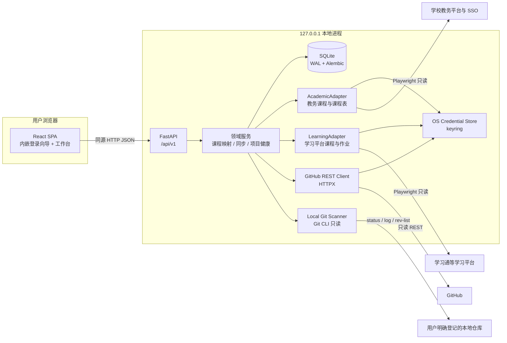

# Student Workbench — 技术栈与部署方案

- 文档版本：0.3.0
- 版本核查日期：2026-11-22
- 目标平台：Windows 优先，架构保持 macOS/Linux 可移植
- 核心决策：本地单进程后端 + 本地 Web 前端 + SQLite，无云端依赖

## 1. 架构决策

### 1.1 为什么需要后端

纯浏览器应用不能可靠完成以下 P0 能力：

- Playwright 教务/学习平台只读自动化和持久会话。
- 本机 Git 仓库扫描。
- GitHub token 的 OS 凭据库保管。
- 后端定时同步、SQLite 事务和跨页面一致的数据查询。

因此保留一个轻量 Python 本地服务是实际需求，不是形式主义的后端分层。

### 1.2 为什么选择 Python

- Playwright 适合处理需要内嵌向导辅助或外部浏览器接管的教务/学习平台登录。
- FastAPI 提供输入校验和 OpenAPI，便于生成前端类型。
- SQLAlchemy + Alembic 能管理明确的关系模型和迁移。
- pytest 适合适配器 fixture、健康规则和临时 Git 仓库的 TDD。
- 后续扩展 Excel、ICS、报表等本地数据处理能力成本较低。

### 1.3 不采用的技术

| 技术 | MVP 不采用的原因 |
|---|---|
| Electron/Tauri | 当前浏览器 + localhost 已足够，避免增加桌面壳和打包复杂度 |
| PostgreSQL/MySQL | 单用户本地场景 SQLite 足够，无需独立数据库服务 |
| Redis/Celery/RabbitMQ | 单用户同步量小，以进程内任务 + SQLite SyncRun 即可 |
| Docker Compose | 本地 Git 路径和可见浏览器跨容器反而复杂 |
| Next.js | 不需要 SSR/SEO，Vite SPA 更轻量 |
| GraphQL | REST + OpenAPI 已满足契约生成和联调 |
| Kubernetes/云部署 | 与本地优先、单机定位冲突 |
| Service Worker 离线缓存 | P0 先避免敏感 API 缓存和陈旧数据问题 |

## 2. 总体架构



内嵌的是工作台登录向导：前端通过本地 API 提交登录输入并展示适配器返回的验证码挑战，Playwright 在本地驱动真实平台。复杂 SSO 或不支持内嵌的流程回退到独立可见 Chromium。P0 不使用 iframe 直接嵌入平台页面，避免 `X-Frame-Options`、CSP、第三方 Cookie 和跨域限制。

## 3. 版本基线

### 3.1 版本策略

- 以下是首次实现的**明确基线**，不是运行 `latest` 的永久承诺。
- Python 直接依赖在 `pyproject.toml` 固定，完整环境由 `uv.lock` 锁定。
- 前端由 `package-lock.json` 锁定，CI 和本地部署使用 `npm ci`。
- 主版本升级单独提交并运行完整回归；安全补丁优先。
- Python 使用 3.13 系列，避免首版同时验证新解释器与全部依赖；CI 使用 3.13 最新可用补丁。
- TypeScript 固定 5.9.3，以满足 `openapi-typescript@7.13.0` 的 `^5.x` peer 约束，而非盲目采用 TS 7。

### 3.2 运行时与包管理

| 组件 | 基线 | 用途 |
|---|---|---|
| Python | `>=3.13,<3.14` | 后端运行时 |
| uv | `0.13.5` | Python 依赖、虚拟环境和命令运行 |
| Node.js | `24.22.2 LTS` | 前端构建与测试 |
| npm | `11.19.1` | 前端依赖锁定与脚本 |
| Git CLI | `2.40+` | 本地仓库只读扫描 |
| SQLite | Python 3.13 自带 3.x | 本地持久化，启动时记录实际版本 |

### 3.3 后端

| 包 | 版本 | 用途 |
|---|---|---|
| `fastapi[standard-no-fastapi-cloud-cli]` | `0.165.0` | HTTP API、静态前端托管、OpenAPI |
| `pydantic` | `2.14.4` | DTO 和输入输出校验 |
| `pydantic-settings` | `2.16.3` | 本地配置读取 |
| `SQLAlchemy` | `2.1.9` | ORM、事务和查询 |
| `alembic` | `1.20.1` | SQLite schema 迁移 |
| `playwright` | `1.65.2` | 学校门户可见浏览器自动化 |
| `httpx` | `0.28.1` | GitHub REST 和 API 测试；不使用 1.0 开发版 |
| `keyring` | `25.7.0` | Windows Credential Manager 等 OS 凭据库 |
| `platformdirs` | `4.14.8` | 跨平台应用数据目录 |
| `pytest` | `9.2.0` | 单元、集成和契约测试 |
| `pytest-asyncio` | `1.5.0` | 异步服务测试；不使用 2.0 alpha |
| `ruff` | `0.17.6` | lint 与格式化 |

说明：FastAPI standard extra 提供本地 ASGI 运行所需的 Uvicorn 等组件；不需要 FastAPI Cloud CLI。所有传递依赖仍以 `uv.lock` 为准。

### 3.4 前端

| 包 | 版本 | 用途 |
|---|---|---|
| `react` / `react-dom` | `19.3.1` | UI |
| `typescript` | `5.9.3` | 静态类型 |
| `vite` | `8.3.8` | 开发服务器与构建 |
| `@vitejs/plugin-react` | `6.2.1` | React 编译集成 |
| `react-router-dom` | `7.18.6` | 页面路由 |
| `@tanstack/react-query` | `5.108.2` | 服务端状态、缓存、mutation |
| `antd` | `6.7.1` | 桌面工作台组件 |
| `dayjs` | `1.11.23` | Ant Design 日期值与时区插件 |
| `openapi-typescript` | `7.13.0` | 从后端 OpenAPI 生成 TS 类型 |
| `vitest` | `5.1.1` | 前端单元/组件测试 |
| `@testing-library/react` | `16.3.2` | 组件行为测试 |
| `@playwright/test` | `1.65.2` | 浏览器端到端测试 |

不引入 Redux/Zustand：P0 的共享服务端状态由 TanStack Query 管理，表单和弹窗使用 React 局部状态。

## 4. 代码与模块边界

```text
student-workbench/
├── apps/
│   └── web/                     # React + Vite
│       ├── src/
│       ├── tests/
│       ├── package.json
│       └── vite.config.ts
├── src/
│   └── student_workbench/
│       ├── api/                 # FastAPI 路由、依赖、异常映射
│       ├── domain/              # 纯领域模型、健康规则、同步归并逻辑
│       ├── integrations/        # platform / academic / learning / github / local_git
│       ├── persistence/         # ORM、Repository、事务
│       ├── services/            # 应用用例与同步协调
│       ├── settings.py
│       ├── main.py
│       └── cli.py
├── tests/
│   ├── unit/
│   ├── integration/
│   ├── contract/
│   └── fixtures/
├── alembic/
├── docs/                        # 本套设计文档
├── pyproject.toml
├── uv.lock
└── README.md
```

依赖方向固定为：

```text
api → services → domain
  ↓       ↓
persistence / integrations → domain DTO
```

`domain` 不导入 FastAPI、SQLAlchemy、Playwright 或 React；教务/学习平台适配器不直接操作 ORM，统一课程映射不依赖具体平台。

## 5. 数据与秘密存储

### 5.1 应用数据目录

Windows 默认：

```text
%LOCALAPPDATA%\StudentWorkbench\
├── data\
│   └── workbench.db
├── browser\
│   └── {connection_id}\
├── logs\
│   └── workbench.log
└── backups\
```

其他平台通过 `platformdirs` 选择等价目录。用户偏好与引导状态只存 SQLite，不另建 `settings.json`；环境级配置通过 CLI 或环境变量提供。项目 Git 仓库只保存代码和非敏感示例配置。

### 5.2 秘密与敏感信息

- GitHub PAT：OS 凭据库，service=`student-workbench`，key=`github`。
- 教务/学习平台密码：默认仅用于当次登录、不保存；用户主动开启“保存密码并自动填充”后，密码存入 OS 凭据库，service=`student-workbench`，key=`platform:{connection_id}`，账号标识存 SQLite。密码保存后不再回传前端、不写日志，自动填充仅限该连接允许的平台/SSO 域名。
- 验证码：通常一次性且不可复用，由用户在工作台内嵌向导或外部平台页面完成；通过持久化会话或平台自身“信任设备”能力减少重复验证，不自动识别或绕过验证码。
- 密码保存属于用户明确开启的便利选项：同一 OS 用户账户下运行的程序可能访问同一凭据库，因此共享电脑或其他 OS 账户场景不应开启；设置页提供随时清除入口。
- 教务/学习平台 Cookie：Playwright 持久化上下文保存，应用数据库不复制 Cookie。
- 数据库：可能包含课程与项目私人信息，备份和导出需按敏感文件处理。
- 日志：记录错误码、域名、同步统计，不记录 Cookie、token、密码和完整页面正文。

### 5.3 SQLite 设置

启动和每个连接按适用方式设置：

```sql
PRAGMA foreign_keys = ON;
PRAGMA journal_mode = WAL;
PRAGMA busy_timeout = 5000;
```

- 使用单进程、单写事务协调；避免多个 Uvicorn worker。
- 同步按事项或明确批次提交，最终 SyncRun 记录结果。
- 所有 schema 变更通过 Alembic，不在启动时 `create_all()` 代替迁移。

## 6. 本地 API 安全

MVP 没有用户登录系统，因此必须限制运行面：

- 仅绑定 `127.0.0.1`，单 worker，不绑定 `0.0.0.0`。
- 生产模式前后端同源，由 FastAPI 托管 `apps/web/dist`。
- 开发模式 Vite 通过同源 `/api` 代理到后端，不向公网暴露 Vite。
- 校验 `Host` 只允许 localhost/loopback 对应值。
- 写请求要求 JSON、`Origin` 同源以及自定义 `X-Student-Workbench-Client` 头。
- 不开放通配 CORS，不设置 `allow_credentials=true` 的跨域访问。
- API 文档仅监听本地；如果未来改公网部署，必须重新设计认证、授权、CSRF 和秘密管理。

## 7. 同步执行模型

- P0 使用 FastAPI 进程内异步任务和持久化 `sync_runs`。
- API 返回 `202 + sync_run_id`，前端轮询状态，不引入 WebSocket。
- 每个连接一个 asyncio lock，数据库中同时检查活动运行，防止重复同步。
- Playwright 和 Git CLI 等阻塞操作放入受控线程，不阻塞 HTTP 事件循环。
- 不依赖 FastAPI `BackgroundTasks` 作为持久任务队列。
- 启动恢复：遗留 `running` → `interrupted`，由用户重试。
- P1 自动同步在相同执行器上增加本地调度，不引入 Celery。

## 8. 开发、测试与运行

### 8.1 初次安装

```bash
uv sync --frozen
uv run playwright install chromium
npm --prefix apps/web ci
```

### 8.2 开发模式

终端一：

```bash
uv run workbench --dev --port 8765
```

终端二：

```bash
npm --prefix apps/web run dev -- --port 5173
```

访问 `http://127.0.0.1:5173`。Vite 将 `/api` 代理到 `http://127.0.0.1:8765`，页面与 API 在前端看来同源。

### 8.3 本地使用模式

```bash
npm --prefix apps/web run build
uv run workbench --port 8765
```

访问 `http://127.0.0.1:8765`。FastAPI 同时提供前端静态资源和 `/api/v1`。CLI 可自动打开默认浏览器，但不以“进程退出码”代替 GUI 已成功打开的验证。

### 8.4 质量检查

```bash
uv run pytest
uv run ruff check .
npm --prefix apps/web run typecheck
npm --prefix apps/web run test -- --run
npm --prefix apps/web run test:e2e
```

真实教务/学习平台验收单独执行，不进入公共 CI，不向 CI 上传平台会话或个人数据。

## 9. CI 与测试环境

- GitHub Actions 使用 `windows-latest` 作为目标平台必跑环境。
- 纯领域单元测试可额外在 Ubuntu 运行，但不替代 Windows 验收。
- 教务适配器使用脱敏课程表 fixture 和 `academic_fake`；学习平台适配器使用脱敏课程/作业 fixture 和 `learning_fake`。
- 内嵌登录使用 fake 挑战流程，外部浏览器回退单独做人工验收；不将真实平台 Cookie、密码或验证码提交仓库。
- GitHub API 使用 HTTPX MockTransport；少量公开 API 冒烟测试显式标记，不作为每次提交必跑。
- 本地 Git 测试在临时目录创建仓库，不扫描 CI 机器上的其他目录。
- E2E 使用独立临时数据库、临时应用数据目录和 fake 适配器。

## 10. 备份与迁移

- P0 提供数据库位置展示和手动备份操作说明。
- P1 实现 JSON 导出与数据库备份按钮。
- Alembic 迁移前先复制数据库文件到 `backups`，失败时不继续启动新版本。
- 备份不包含 OS 凭据库 token；浏览器会话是否纳入备份默认否。
- 不把数据库、会话、日志和备份上传 GitHub。

## 11. 后续扩展约束

- 第二教务平台：实现相同 `AcademicAdapter` 契约；其他学习平台：实现相同 `LearningAdapter` 契约。新增平台通过 `course_identities` 加入统一课程，不修改核心 WorkItem。
- 自动同步：复用同一同步协调器，禁止绕过连接锁。
- 桌面壳：只有用户明确需要单图标启动和系统托盘时再引入。
- 云同步/多人：属于新产品阶段，需要重新设计认证、冲突、加密和部署，不在当前架构上简单暴露端口。
